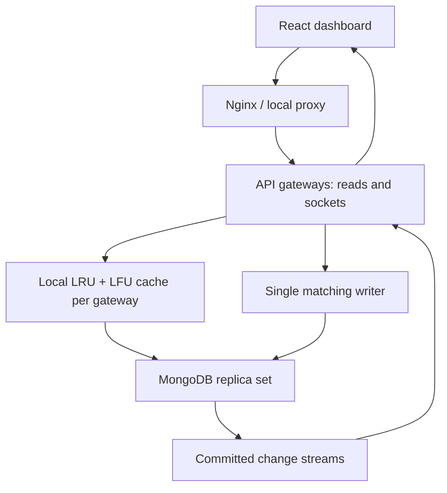
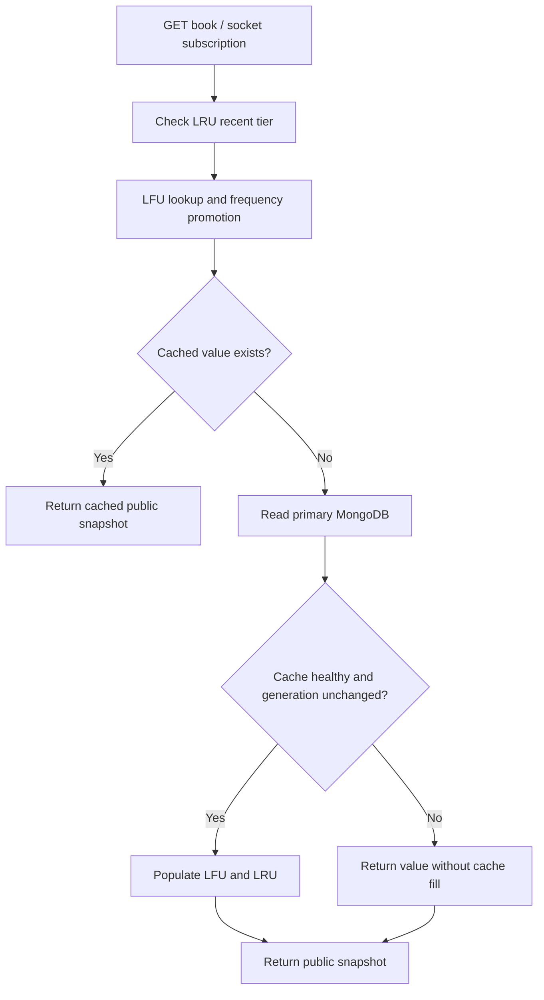
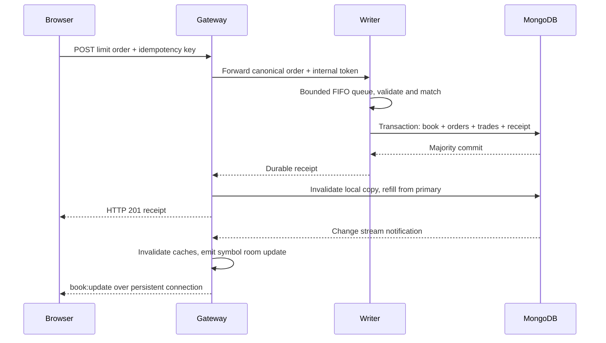

# ApexEngine — Distributed Order Book & Custom Cache Dashboard

An independently written, interview-ready educational project combining a React monitoring terminal, Node.js/Express APIs, Socket.io, MongoDB transactions, a custom LFU cache with LRU tie-breaking, an LRU front tier, Docker Compose, and Kubernetes manifests.

**Start here:** run the dashboard in Demo mode immediately, then run the complete stack and switch to Live. Demo numbers are synthetic. Live numbers come from actual requests handled by the connected backend process. This application simulates orders; it does not connect to an exchange or handle real money.

## 1. What problem are we solving? In everyday language

Imagine a shop with a notebook containing every item and its latest price. Every customer asking for a price makes the shopkeeper walk to the storeroom, open the notebook, and come back. Even if everyone asks about the same three items, the trip repeats. The notebook is our database; the repeated trip is database I/O.

A cache is a small desk near the counter holding copies of commonly requested information. Checking the desk is cheaper than taking another trip. But the desk has limited room. Which information should stay?

- **LRU — Least Recently Used:** keep information people accessed recently; remove the item nobody has touched for the longest time.
- **LFU — Least Frequently Used:** keep information people access often; remove the item with the lowest access count.
- **LFU with an LRU tie-break:** if two items have the same frequency, remove the older access first.

ApexEngine applies these rules to snapshots of a simulated market order book. It also answers a harder question: what happens when the notebook changes while several desks contain copies? The write commits to MongoDB first. MongoDB change streams notify each API process, and each process removes its old copy.

An **order book** is the waiting list of buy and sell requests for a market. A buyer sets the highest price they will pay; a seller sets the lowest price they will accept. If the prices overlap, the engine matches them. The dashboard shows this activity and the system's cache behavior.

### A concrete matching example

1. Alice offers to sell five units at $100.00.
2. Bob requests three units and is willing to pay $110.00.
3. The engine executes three units at the existing seller's price, $100.00.
4. Bob's order is filled; Alice has two units left waiting.
5. MongoDB stores the new book, trade, and order states in one transaction.
6. API replicas invalidate their old cached book.
7. Socket.io delivers the changed market to subscribed dashboards.

The names above are explanatory examples. The implementation has no account or user identity system.

## 2. Project scope and deliverables

| Included | Exact scope |
|---|---|
| Order matching | Limit buys/sells, best price then arrival sequence, partial fills, resting-price execution |
| Markets | BTC_USDT, ETH_USDT, SOL_USDT, AAPL, MSFT, NVDA; simulated USD prices |
| Cache | Independently written Hash Maps and doubly linked lists; L1 LRU and L2 LFU |
| Persistence | MongoDB books, order states, original submission receipts, and trades |
| Consistency | Transactional writes, a single matching writer, asynchronous replica cache invalidation |
| Retry protection | Required idempotency key; identical retries reuse their original receipt |
| Live UI | Socket.io subscription rooms, 800ms rendering batch, bounded buffers |
| Deployment | Multi-stage images, Compose stack, optional Kubernetes learning deployment |
| Verification | Unit/property-style tests, integration tests, cache and HTTP benchmark scripts |

The matching writer is intentionally a single instance. Read gateways can replicate. **Distributed here describes the separation of the writer, database, gateways, and dashboard, and the propagation of committed changes. It does not mean the matching algorithm itself is distributed across writers.**

Not implemented: real exchange feeds, payment settlement, authentication, positions, risk limits, market orders, cancellation, order modification, short selling rules, fees, consensus, leader election, cross-region failover, or production security. The book rejects new submissions once 1,000 resting orders exist for a symbol, including submissions that might otherwise cross; this is a deliberately simple protective limit. The bounded embedded trade list is a recent display view; the separate `trades` collection preserves all trades.

## 3. Technology stack and why it is here

| Technology | Role | Why it fits |
|---|---|---|
| JavaScript / Node.js | Cache and application services | Builds on your MERN experience; asynchronous database/network I/O |
| Express | HTTP routing and validation | Small, understandable API layer |
| MongoDB / native driver | Durable state and transactions | Book/order/trade commits and change streams without a second broker |
| Socket.io | Persistent browser stream | Reconnection, event names, and symbol-specific rooms |
| React | Single-page dashboard | Component composition, hooks, and batched state updates |
| Recharts | Moving line chart | Responsive visualization without a large UI kit |
| Standard CSS | Dark terminal interface | No heavy UI component dependency |
| Custom Maps + DLLs | LRU/LFU | Demonstrates data structures rather than outsourcing the cache to Redis |
| Docker / Compose | Repeatable local stack | One command builds services and initializes the database replica set |
| Kubernetes | Optional cluster exercise | Services, replica gateways, probes, persistence, optional HPA/Ingress |
| Node test runner | Verification | No separate unit-test framework required |

Exact dependency versions are recorded in `package.json` files and `package-lock.json`. Use Node.js **22.14+ or 24 LTS** and npm **10+**. Dockerfiles use Node 22. Neither Java nor Redis is required. Code is independently written; third-party packages retain their own licenses.

## 4. Architecture and flow diagrams

GitHub and many Markdown viewers render the Mermaid diagrams below. Open `docs/architecture.html` in any browser for an additional visual architecture guide that needs no Mermaid renderer.



### Read path



### Write path: transaction first



The change event and HTTP response can arrive in either order after commit. The database is authoritative in both cases. Other gateways observe the change asynchronously.

## 5. Directory tour

```text
apexengine/
  README.md                       Main explanation and runbook
  package.json                    npm workspaces and shared commands
  package-lock.json               Reproducible dependency resolution
  compose.yaml                    Local multi-service deployment
  backend/
    package.json                  Backend dependencies and scripts
    .env.example                  Local development configuration template
    Dockerfile                    Dependency stage + non-root runtime
    src/
      server.js                   REST routes, sockets, metrics, invalidation
      store.js                    MongoDB transaction and bounded write queue
      matching.js                 Pure matching algorithm and public book view
      cache/
        list.js                   Sentinel doubly linked list
        lru.js                    LRU front tier
        lfu.js                    Frequency buckets and LRU tie-breaking
        tiered.js                 Two-tier coordination and invalidation
    test/
      cache.test.js               Cache behavior and reference-model checks
      matching.test.js            Matching and quantity conservation
      integration.test.js         HTTP retries, conflict, lookup, hot reads
  frontend/
    package.json                  React, Recharts, Socket.io client, Vite
    index.html                    Browser entry point
    vite.config.js                Development API/WebSocket proxy
    Dockerfile                    Vite build + unprivileged Nginx runtime
    nginx.conf                    Static files, HTTP proxy, WebSocket upgrade
    src/
      main.jsx                    React root and CSS import
      App.jsx                     Complete dashboard and live/demo state
      styles.css                  Responsive terminal-style design
  deploy/
    mongo-init.sh                 Idempotent local replica-set initialization
    k8s/
      namespace.yaml              Isolated application namespace
      config.yaml                 Non-secret backend configuration
      mongo.yaml                  StatefulSet, headless Service, PVC, init Job
      engine.yaml                 One matching writer, Recreate strategy
      gateway.yaml                Three read gateways, rolling strategy
      frontend.yaml               Browser app and service
      hpa.yaml                    Optional CPU-based gateway autoscaler
      ingress.yaml                Optional NGINX Ingress routing
  scripts/
    simulate.mjs                  Places real API orders in the fake market
    load.mjs                      Bounded HTTP load and latency measurements
    benchmark.mjs                 In-process LFU microbenchmark
  docs/
    architecture.html             Offline visual architecture explainer
    interview-guide.md            Infosys preparation and likely questions
    verification.md               What was actually run in the build environment
    sample-cache-benchmark.json    Recorded microbenchmark output
```

The directory tree is a file map. Architecture diagrams above explain execution flow.

## 6. Fastest start: complete stack with Docker

Prerequisites: Docker Engine/Desktop running, Compose v2, and free ports 8080, 4000, 27017. On Windows, use Docker Desktop with Linux containers. Download and extract the ZIP before running commands.

```bash
cd apexengine
docker compose up --build -d
docker compose ps
```

Open **http://localhost:8080**. The dashboard starts in **Demo** mode so the layout immediately has a moving chart and logs. Click **Live** to connect to the backend. Initially, actual operations/sec may be zero; this is correct when no requests are arriving.

Generate actual traffic from another terminal:

```bash
npm ci
node scripts/simulate.mjs
```

The simulator submits one order approximately every 800ms and performs a read. It alternates buy/sell waves at fixed prices across six symbols, producing real persisted orders in a simulated market. Stop it with Ctrl+C. It is a demo traffic generator, not a benchmark or external market feed.

Inspect services:

```bash
docker compose logs -f engine gateway
curl http://localhost:4000/health/ready
curl http://localhost:4000/api/metrics
```

Stop without deleting your database:

```bash
docker compose down
```

`docker compose down -v` also deletes the database volume; use it only when you intentionally want a fresh demo database.

### What Compose starts

1. MongoDB starts with replica-set mode enabled.
2. The one-shot init container initializes `rs0` and waits for primary election.
3. The matching engine waits for database initialization.
4. The gateway waits for engine readiness.
5. Nginx serves the frontend and proxies its API/socket requests.

A single-member replica set supports transactions and change streams but offers **no database high availability**. This choice keeps the interview setup small. MongoDB is exposed only on the local loopback interface; the provided configuration has no database authentication and is intended for local exercises.

## 7. Run just the UI, or develop locally

### UI-only mock dashboard

```bash
npm ci
npm run dev:ui
```

Open **http://localhost:5173** and keep Demo selected. This directly satisfies the UI prompt: three metric cards, moving hits/misses chart, streaming cache terminal, and a timer updating every 800ms. It also adds market depth, a frequency view, and an order form.

**Copy-pasteable React source:** `frontend/src/App.jsx` plus `styles.css`, with `main.jsx` as the entry point. Install `react`, `react-dom`, `recharts`, and `socket.io-client`, and use a Vite React-compatible project. The full project already includes the required configuration. There are no UI-kit dependencies or external image/font requests.

### Live local development

Start only the database:

```bash
docker compose up -d mongo mongo-init
cp backend/.env.example backend/.env
npm ci
npm run dev:api
```

In another terminal:

```bash
npm run dev:ui
```

The backend reads `backend/.env` because the workspace script runs there. Locally, `ROLE=engine` lets one process handle reads and matching, reducing the number of processes needed while retaining the same code. Vite proxies `/api` and `/socket.io` to port 4000.

The local Mongo URI uses `directConnection=true`: the replica set advertises `mongo:27017` inside Docker, while host-side Node connects through localhost. The driver still talks to a replica-set primary and supports transactions.

PowerShell equivalent for copying the env file: `Copy-Item backend/.env.example backend/.env`. If host port 4000 is already occupied by the full Compose gateway, stop that gateway/frontend first or use the complete Compose stack instead of host development.

## 8. REST API and practical examples

All prices use **integer cents**; quantities use whole units. This avoids representing $0.10 as an imprecise floating-point financial amount. The UI displays dollars and converts entered prices to cents.

| Method | Path | Behavior |
|---|---|---|
| GET | `/health/live` | Process alive |
| GET | `/health/ready` | Database ping succeeds; includes cache status |
| GET | `/api/symbols` | Supported markets |
| GET | `/api/book/:symbol` | Public aggregated levels and recent trades; cached |
| POST | `/api/orders` | Validate, forward to writer if necessary, match, commit |
| GET | `/api/orders/:id` | Current persisted order state; direct DB read |
| GET | `/api/metrics` | Counters/cache for this API process |
| POST | `/internal/orders` | Writer-only forwarding endpoint; shared internal token |

Example using Bash, macOS, Linux, Git Bash or WSL:

```bash
curl -X POST http://localhost:4000/api/orders \
  -H 'Content-Type: application/json' \
  -H 'Idempotency-Key: interview-sell-001' \
  -d '{"symbol":"BTC_USDT","side":"sell","priceCents":10000,"quantity":5}'

curl -X POST http://localhost:4000/api/orders \
  -H 'Content-Type: application/json' \
  -H 'Idempotency-Key: interview-buy-001' \
  -d '{"symbol":"BTC_USDT","side":"buy","priceCents":11000,"quantity":3}'

curl http://localhost:4000/api/orders/interview-sell-001
curl http://localhost:4000/api/book/BTC_USDT
```

Use a fresh demo database for the exact Alice/Bob example; pre-existing orders can match first. PowerShell can use `curl.exe`, or `Invoke-RestMethod` with equivalent headers and a JSON body.

### Idempotency and failure handling

A key must be 8–80 characters long, using letters, numbers, underscores or hyphens. It uniquely identifies an order submission across all symbols.

- Same key + same canonical order: return the original submission receipt without placing another order.
- Same key + different order: HTTP 409.
- Original receipt remains the original receipt even if the resting order fills later. Use the order lookup endpoint for its current state.
- If a network timeout makes the commit outcome uncertain, retry the same payload with the same key.
- The UI retains the key for a failed submission with unchanged form values. A changed payload gets a new key.

Malformed requests receive 400; a full demo book receives 422; missing orders receive 404; an exhausted writer queue receives 503. Infrastructure errors return a generic retry message. There is no financial account ledger or settlement layer.

## 9. Custom LFU/LRU cache: how it actually works

### Data structures

`entries`: a Map from key to a node containing `{ key, value, freq, prev, next }`.

`buckets`: a Map from frequency to a doubly linked list of nodes with that exact frequency.

`minFreq`: the smallest frequency currently present.

Each list has a dummy head and dummy tail. Real nodes are appended at the tail. The first real node after the head is the least recently accessed node in that frequency bucket.

The implementation lives in [`backend/src/cache/lfu.js`](./backend/src/cache/lfu.js), with the sentinel-based list in [`backend/src/cache/list.js`](./backend/src/cache/list.js). `_promote(node)` unlinks the node from its current frequency bucket, removes the bucket if it becomes empty, increments the frequency, and appends the node to the next bucket's tail. If the emptied bucket was `minFreq`, the promoted node guarantees that `minFreq` advances to the next frequency.

### `get(key)`

1. Look up the node using `entries`.
2. If absent, report a miss (`undefined`).
3. Call `_promote(node)` to move it to the next frequency and refresh its recency.
4. Return its value.

### `put(key, value)`

Existing key: replace the value and promote its frequency as an access.

New key:

1. If capacity is zero, store nothing.
2. If full, remove the head node from `buckets.get(minFreq)`.
3. Remove that key from `entries`.
4. Add the new node to frequency 1 at the tail.
5. Set `minFreq = 1`.

### Small dry run

| Operation, capacity 2 | Frequency 1, oldest → newest | Frequency 2 | Eviction |
|---|---|---|---|
| put(A) | A | — | — |
| put(B) | A, B | — | — |
| get(A) | B | A | — |
| put(C) | C | A | B |
| get(C) | — | A, C | — |
| put(D) | D | C | A, older among frequency-2 keys |

### Why doubly linked lists?

A Map gives the exact node address. A doubly linked list lets us detach that node without traversing the list to find its predecessor. Removing a known node and appending a node each require a constant number of pointer updates. A plain array would need scanning or shifting.

### Complexity, precisely stated

| Operation | Complexity |
|---|---|
| LFU get / put / capacity eviction | Expected O(1) under usual Map/hash assumptions |
| LRU get / put / delete | Expected O(1) |
| LFU arbitrary delete / invalidation | O(F) worst case if removing the final minimum bucket; F = frequency bucket count |
| Cache snapshot for telemetry | O(C), C = cache entry count |
| Cache space | O(C) |
| Matching / sorting / cloning | Bounded demo operations, not constant time; see matching section |

Do not say “absolute O(1) in all circumstances.” JavaScript Maps, garbage collection, and memory allocation do not provide a hard real-time guarantee. The core cache operations do avoid a linear search through entries for ordinary access and capacity eviction.

### How the two tiers cooperate

L1 tracks the most recent cached values. L2 is the authoritative bounded LFU working set. An L1 hit still promotes the corresponding L2 frequency; otherwise a hot item repeatedly served by L1 could incorrectly appear cold to LFU. L2 evictions also remove the key from L1. This design demonstrates two policies but does **not** claim L1 removes the need for LFU bookkeeping or independently proves a latency advantage over LFU alone.

The application caches public book snapshots, not all order histories or immutable account balances. Default capacities 2/4 are deliberately tiny so six markets visibly cause eviction. They can be increased using environment variables.

Limitations: no TTL, no frequency decay/aging, no byte-based memory budget, no cross-process shared cache, and no cache-stampede coalescing. Frequencies grow for the lifetime of entries; a long-running production implementation would need an aging strategy and numeric overflow handling. Cached values should be treated as immutable; this application serializes them to clients and does not mutate them.

## 10. Consistency, transactions, and multi-process safety

The write pattern is **commit-first write-through/refill**: matching updates durable state in a MongoDB transaction, then the writer and submitting gateway invalidate and refill their local cached snapshot. Other gateways invalidate using change streams. Cache refill failure does not roll back an already committed order; the next read can fetch the database.

The transaction includes:

- the authoritative book document;
- changed resting order states;
- new trade documents;
- the incoming order's current state;
- its idempotency request and original receipt.

MongoDB's primary is the source of truth. The in-memory cache is disposable. Restarting a Node process loses the cache but not committed order state. Matching reconstructs state from MongoDB for each incoming order; the matching algorithm never trusts a possibly stale cache.

### Why one matching writer?

Node's event loop does not make several awaited database operations an indivisible action. Two requests can overlap around an `await`. `Store.submit` chains incoming tasks onto a Promise FIFO, with a maximum of 500 accepted pending tasks. Transaction retries provide an additional database layer of protection.

All gateway writes forward to this one writer. Do not scale the writer Deployment above one replica. There is no fencing or leader election in this project. Scaling matching safely would require symbol partitioning, explicit ownership, or a durable sequencer/leader architecture.

### Cache invalidation across gateways

Every gateway watches the `books` collection independently. Each committed change clears the affected key in both local tiers and sends the current public book to that gateway's local socket clients. There is no Redis cache and no separate Socket.io adapter. MongoDB is the common committed-change source.

If the stream errors or reconnects, the gateway clears its cache and bypasses caching until a fresh stream is established. Reopening starts a new stream and fetches fresh state on demand; there is no application-managed resume-token store or durable replay of every socket event.

An invalidation arriving during an asynchronous database read changes a per-symbol generation counter. A read only fills the cache if that counter is unchanged. This prevents a common stale-refill race. The generation map is bounded by the fixed market list.

**Consistency limit:** remote invalidation is asynchronous. Another gateway can briefly serve an old cached snapshot between commit and notification. An order acknowledgement does not establish global linearizable cached reads. A silently stalled stream can also leave stale data until a driver error is detected; there is no periodic freshness audit/TTL. Strict global freshness would need revision validation or stronger coordination. Readiness checks database access, not the writer route or strict cache freshness.

## 11. WebSocket implementation, step by step

Socket.io adds event framing, reconnection and rooms on top of a persistent transport. A plain raw-WebSocket client will not speak the Socket.io protocol.

1. React creates `io({ transports: ['websocket'] })` in Live mode.
2. The backend accepts connections with WebSocket-only transport.
3. On connection, the client sends `subscribe(symbol)`.
4. The backend moves that socket to the selected symbol's room and fetches an initial snapshot.
5. MongoDB book changes trigger `book:update` for that symbol room.
6. An independent backend timer sends `telemetry` every 800ms.
7. Client handlers place the latest telemetry/book into refs.
8. The UI timer applies those refs to React state at most once every 800ms.
9. On unmount or mode switch, listeners are removed and the socket disconnects.
10. On reconnect, the client resubscribes and receives a current snapshot.

| Event | Direction | Payload / purpose |
|---|---|---|
| subscribe | Client → server | Supported symbol; join a room and get snapshot |
| book:update | Server → symbol room | Aggregated bids/asks, revision, last price, recent trades |
| telemetry | Server → all local clients | Rates, read counts, cache snapshot, bounded logs |
| service:error | Server → client | Temporary snapshot-read failure |

Because this project forces WebSocket transport, one persistent connection belongs to one gateway; HTTP long-polling sticky-session requirements do not apply. **Sticky sessions do not synchronize cache state.** An Ingress must still forward the WebSocket upgrade. Reconnection may land on another gateway, so counters can reset/change scope. Each gateway publishes to its own connected sockets after independently observing MongoDB; we do not invoke global room broadcasting through a shared Socket.io adapter.

Socket events are monitoring updates, not a durable delivery channel. Intermediate snapshots can be dropped/coalesced in the UI. Orders themselves use REST plus durable idempotency. There is no guarantee that every trade event is seen exactly once by a browser.

## 12. React performance and dashboard behavior

The requested single-page layout includes:

- ApexEngine header and connected status;
- three metric cards;
- moving cache-hits/database-misses chart;
- black cache terminal with green logs;
- market depth, cache frequencies, and a limit-order form.

Performance choices:

- 800ms timer: a deliberate ~1.25Hz **data refresh**, not a claim of 60 data updates/sec.
- Latest socket packet/book stored in refs: a burst does not create one React update per incoming message.
- React batches timer-driven state changes.
- `memo` wraps chart/terminal components; `useMemo` calculates the peak read count.
- Chart animation is disabled so new data does not continuously interpolate.
- Chart history is capped at 45 samples (~36 seconds at 800ms).
- UI log buffer is capped at 120 lines. The backend stores 120 and transmits only the latest 25 per tick.
- Terminal follows new events only while the reader is already near its bottom.
- Book display has bounded price levels and recent trades.
- Symbol and revision checks reject unrelated/out-of-order book snapshots.
- Cleanup prevents duplicate timers/listeners during React StrictMode mount checks.

Pause freezes the displayed state; the socket remains connected and retains the latest update. Resume shows current data, without replaying every missed interval. This bounds work at the cost of losing intermediate monitoring samples.

**Important terminology:** React refs and batching are not CPU “memory barriers.” That phrase should not appear in your resume for this implementation. A 60 FPS claim requires browser performance measurements on specified hardware/workloads; this project makes no such claim.

### Metric definitions

| Card/chart | Live definition |
|---|---|
| Cache hit rate | Cumulative book cache hits / (hits + misses), on one backend process |
| Operations/sec | Book read calls + successful order acknowledgements over actual elapsed tick duration; retries/refills can count |
| DB latency | Mean timed MongoDB book-read duration in the last telemetry interval; includes driver/network/decode time |
| DB latency shown as `—` | No book database reads occurred in that interval |
| Chart hits/misses | Number of book cache hits/misses in that 800ms backend interval |
| Metrics endpoint | Process totals, not cluster-wide aggregation or all Mongo queries |

Transactions, order lookups, health checks and change-stream fetches are not counted as `dbReads`. The hit rate is not automatically the percentage reduction of all database I/O. Demo metrics do not measure any of these quantities.

## 13. Docker level used

This is a practical **intermediate local containerization setup**:

- multi-stage backend image: install only backend production dependencies, then copy runtime files;
- multi-stage frontend image: build React assets with Node, serve with unprivileged Nginx;
- non-root application/frontend runtimes;
- Docker network service names for communication;
- persistent MongoDB named volume;
- health checks and startup dependency conditions;
- one-shot replica-set initialization;
- environment-driven configuration;
- graceful backend shutdown and a stop grace period;
- a WebSocket-capable Nginx proxy.

Image sizes were not assumed or invented. Multi-stage builds remove frontend build tooling from its runtime image, but exact image sizes require `docker images` measurements on your machine. The included scripts and lockfile make environment replication easier; they do not demonstrate that peer review happened historically.

## 14. Kubernetes level used

Kubernetes is an **optional foundational deployment exercise**, with some intermediate features included as manifests:

- Namespace, ConfigMap, shared Secret created by command;
- Deployments and ClusterIP Services;
- one MongoDB StatefulSet with a persistent volume claim and headless Service;
- database init Job;
- startup/readiness/liveness probes for backends;
- CPU/memory requests and limits;
- three gateway replicas;
- gateway rolling updates with `maxUnavailable: 0`, `maxSurge: 1`;
- one writer with `Recreate`, preventing intentional overlapping writer pods;
- optional CPU HPA from three to six gateways;
- optional NGINX Ingress with socket timeouts.

There is **no claim of a measured zero-downtime whole-system rollout**. The writer uses Recreate and temporarily stops accepting writes during replacement. Gateway sockets can disconnect during gateway rollout and reconnect. Single-member MongoDB has no failover redundancy. A deployment policy is not proof of an availability guarantee.

### Local Kubernetes exercise using Minikube

Prerequisites: kubectl, Minikube, Docker, a default StorageClass and enough RAM. These commands are a runbook, not evidence that a cluster was executed in the build environment.

```bash
minikube start --memory=4096
# Bash: build images in Minikube's Docker daemon.
eval $(minikube docker-env)
docker build -t apexengine-backend:local -f backend/Dockerfile .
docker build -t apexengine-frontend:local -f frontend/Dockerfile .

kubectl apply -f deploy/k8s/namespace.yaml
kubectl create secret generic apex-secret -n apexengine \
  --from-literal=INTERNAL_TOKEN=replace-with-a-long-local-shared-token
kubectl apply -f deploy/k8s/config.yaml
kubectl apply -f deploy/k8s/mongo.yaml
kubectl wait -n apexengine --for=condition=complete job/mongo-init --timeout=180s
kubectl apply -f deploy/k8s/engine.yaml
kubectl apply -f deploy/k8s/gateway.yaml
kubectl apply -f deploy/k8s/frontend.yaml
kubectl rollout status deployment/gateway -n apexengine
kubectl port-forward service/frontend -n apexengine 8080:8080
```

Open http://localhost:8080 and select Live. For PowerShell, use Minikube's documented Docker environment command or `minikube image load` after host-side image builds. Replace the sample token before use. A base64 Kubernetes Secret is not encryption at rest by itself.

Mongo initialization uses direct pod DNS rather than the headless Service selector, so it can initialize Mongo before the primary-readiness probe succeeds. If your cluster has no default StorageClass, the PVC remains Pending; install/configure storage first.

Optional autoscaling:

```bash
minikube addons enable metrics-server
kubectl apply -f deploy/k8s/hpa.yaml
kubectl get hpa -n apexengine
```

Optional Ingress: enable/install an NGINX Ingress Controller, change `CORS_ORIGIN` to `http://apexengine.local`, apply the Ingress manifest, restart backend Deployments to load the configuration, and map `apexengine.local` to your cluster's reachable address. Port-forward access needs no Ingress.

Use a new immutable image tag for actual rollout exercises; edit the manifest image or use `kubectl set image`. Reusing `:local` with IfNotPresent can keep an old image on a node. Autoscaling requires working resource metrics and CPU requests. It scales gateways only; it does not remove the writer bottleneck.

## 15. Tests and benchmarking

### Unit/property-style tests (no database needed)

```bash
npm ci
npm test
npm run build
```

Tests cover LFU behavior, LRU ties, frequency gaps after invalidation, zero capacity, falsey values, front-tier frequency promotion, 10,000 seeded cache operations versus a simple reference model, crossing/noncrossing orders, FIFO, partial fills, validation, and quantity conservation across 500 seeded matching steps.

### HTTP integration tests

With the full stack running:

```bash
npm run test:integration
```

These tests intentionally create simulated persistent orders. They check concurrent same-key submission, conflict rejection, current-state lookup, hot reads, malformed input rejection, and a Socket.io subscription receiving a committed book update. They do not automatically prove all distributed failure scenarios.

### In-process cache microbenchmark

```bash
npm run benchmark
```

The output is saved under `backend/benchmark-results-cache.json`, because npm runs this workspace script from `backend/`. See `docs/sample-cache-benchmark.json` for the measurement collected during this build.

This is a **synchronous LFU get-only microbenchmark**, with 1,000 stored keys, a 1,200-key access cycle and 50,000 warmup operations. It uses a no-op logging callback and does not include HTTP, sockets, MongoDB, serialization, transaction cost, or React. Do not turn its operations/sec into a platform throughput claim.

### HTTP read benchmark and cache on/off comparison

Use a single gateway and stop the traffic generator to avoid mixing load conditions:

```bash
# Cache on: default Compose configuration.
docker compose up -d
API_URL=http://localhost:4000 RESULT_FILE=cache-on.json node scripts/load.mjs

# Disable caches and recreate backend containers.
CACHE_ENABLED=false docker compose up -d --force-recreate engine gateway
API_URL=http://localhost:4000 RESULT_FILE=cache-off.json node scripts/load.mjs

# Restore normal operation.
CACHE_ENABLED=true docker compose up -d --force-recreate engine gateway
```

To run both measurements, restore cache-on even if a benchmark step fails, validate the active cache mode, and print a data-derived comparison:

```bash
node run-benchmarks.js
```

This cross-platform Node.js script writes `cache-on.json` and `cache-off.json` in the project root. Its mean database-read comparison is `databaseReadsDelta / successful requests` for each run, so it remains meaningful when successful request counts differ. It compares cache-off and cache-on p50/p95/p99 attempt latencies and reports throughput and errors for both runs. Both measurements must use the same API, duration, and concurrency; the summary is evidence from that run, not a guaranteed result or compensation claim.

The script checks for a free host port for MongoDB, starting at 27017, and passes it to Compose as `MONGO_PORT`; set `MONGO_PORT` explicitly to pin a port. This avoids disrupting a local MongoDB that already occupies 27017.

Set `CONCURRENCY=10` and `DURATION_SECONDS=15` or change both equally for each run. Use the direct gateway on port 4000 so before/after metrics come from one known process. For a multi-replica cluster, gather every process's counters rather than subtracting two randomly routed endpoint responses.

Record hardware, runtime, dataset, concurrent traffic, duration, sample count and environment. `load.mjs` reports successful requests/sec, p50/p95/p99 completed-attempt latency, error rate, and book DB-read/cache-hit deltas. It caps retained latency samples at the first 200,000 completions. CPU/RAM in its output belong to the load-generator process; use `docker stats` or cluster tooling for server resources.

A book-read reduction can be calculated as `(disabled book DB reads - enabled book DB reads) / disabled book DB reads × 100`, **only under comparable successful request counts/workloads**. Normalize DB reads per successful read when throughput differs. This still excludes other Mongo operations. Do not claim an arbitrary “85% database reduction.”

#### Recorded HTTP benchmark

One local run collected on **2026-10-11** using Docker Compose and `node run-benchmarks.js`:

| Metric | Cache on | Cache off |
|---|---:|---:|
| Cache mode verified | Enabled | Disabled |
| Duration / concurrency | 15 s / 10 workers | 15 s / 10 workers |
| Attempts / successes / errors | 17,509 / 17,509 / 0 | 6,869 / 6,869 / 0 |
| Successful throughput | 1,166.61 req/s | 457.41 req/s |
| p50 attempt latency | 7.44 ms | 19.44 ms |
| p95 attempt latency | 16.96 ms | 40.70 ms |
| p99 attempt latency | 25.12 ms | 54.46 ms |
| Gateway book DB reads | 12 | 6,869 |
| Book DB reads per successful request | 0.0007 | 1.0000 |
| Cache hits | 17,497 | 0 |

Normalizing by successful requests gives `(1 - (12 / 17,509) / (6,869 / 6,869)) × 100 = 99.9315%` fewer **book reads per successful request** with cache enabled for this run. The observed cache-on p50, p95 and p99 were respectively 61.7518%, 58.3306% and 53.8682% lower than cache-off; successful throughput was 1,166.61 versus 457.41 requests/s. Both runs had zero request errors.

This is a single local sample, not a statistically repeated experiment or production result. Both configurations used the same API URL, duration, and concurrency, but were run sequentially against recreated containers; throughput, latency, machine load, Mongo state and scheduling can vary. DB-read counters are gateway-local and count **book reads only**, not all MongoDB operations. The test does not measure server CPU/RAM or establish capacity, availability or production performance. Re-run with controlled repetitions before presenting the figures as a general performance claim.

## 16. What we achieved and what you can defend

We implemented an end-to-end simulated trading workflow with deterministic matching, durable transactional state, idempotent submission, an original LFU/LRU cache, per-process metrics, a persistent socket stream, and a dashboard with bounded update work. We provided repeatable deployment configurations and meaningful tests.

See `docs/verification.md` for the exact checks that ran and any environment limits. Performance and infrastructure claims are deliberately separated from configuration. No fixed salary/package, selection result, measured 60 FPS, production availability, real-money suitability or million-HTTP-requests/sec claim follows from this code.

### Resume wording aligned with your supplied bullets

If this was actually your Eisystems assessment, the following wording fits the implementation:

- **Capstone Assessment Project:** Developed ApexEngine, a simulated order-book platform with real-time streaming and a custom caching module for a training assessment.
- **Real-Time Pipelines:** Integrated Socket.io with Node.js/Express to stream market snapshots and telemetry into a React dashboard with bounded buffers and 800ms batched updates.
- **Custom Algorithmic Cache:** Implemented LFU using Hash Maps and doubly linked frequency lists, with expected O(1) get/put and LRU tie-breaking, to serve repeated book reads from memory.
- **Containerized Deployment:** Added multi-stage Docker images and a Compose environment for the frontend, gateway, matching engine and MongoDB replica-set setup.

Use the employer, dates and “final assessment” wording only if those historical details are true. Building this now does not establish that it was completed during May–July 2025. Otherwise list it as an independent project. The code supports explaining technical work; it cannot substantiate internship history or peer-review events.

Kubernetes can be listed as “deployment manifests / local deployment exercise” until you actually execute and understand the runbook. Do not add Kubernetes to an experience bullet solely because YAML exists.

## 17. Troubleshooting

| Symptom | Likely cause / action |
|---|---|
| Demo connected badge but no backend | Expected: Demo explicitly marks the connection simulated; switch to Live |
| Live disconnected | Start backend; inspect gateway logs and proxy configuration |
| Live throughput is zero | Send reads/orders or run the simulator; live telemetry is not random |
| Live latency shows a dash | No book DB reads in that interval; hot cache reads don't require one |
| Transaction error about replica set | Standalone MongoDB is insufficient; initialize rs0 |
| Mongo hostname unreachable on host | Use the provided localhost directConnection URI for host development |
| Cache bypassed | Change stream isn't healthy; inspect Mongo configuration/logs |
| Only four symbols in cache | Default LFU capacity is four; eviction is intentional |
| Same idempotency key rejected | You changed the payload; use a new key for a new order |
| Writer temporarily unavailable on rollout | Recreate strategy intentionally pauses writes; retry same key |
| Kubernetes PVC Pending | Missing/default StorageClass or insufficient storage |
| HPA says unknown metrics | Metrics Server/resource metrics unavailable |
| Connection drops during rollout | Browser reconnects and requests snapshot; monitoring is not durable replay |
| Browser shows empty market depth | No resting orders yet, or selected market hasn't received a snapshot |
| Orders return capacity error | Reset a disposable demo DB or use another symbol; don't silently discard orders |

## 18. Suggested extension roadmap

1. Add cancellation and modification with transactional audit trails.
2. Move matching to per-symbol ordered price structures and benchmark them against array sorting.
3. Add byte budgets, TTL and frequency aging to the cache; coalesce simultaneous misses.
4. Add validated authentication, authorization, rate limits and input schema tooling.
5. Add request tracing, Prometheus metrics and cluster-wide aggregation.
6. Partition symbols between fenced writer owners before scaling matching.
7. Use a proper multi-member authenticated MongoDB replica set and test failover.
8. Add persistent event offsets/replay if clients need every trade rather than latest snapshots.
9. Measure browser rendering under a documented burst workload.
10. Add CI and test container builds/deployment/failure recovery on your own infrastructure.

## 19. Official references for further study

- [MongoDB change streams](https://www.mongodb.com/docs/manual/changestreams/)
- [MongoDB transactions, Node driver](https://www.mongodb.com/docs/drivers/node/current/fundamentals/transactions/)
- [Socket.io with multiple nodes](https://socket.io/docs/v4/using-multiple-nodes/)
- [Socket.io client transport options](https://socket.io/docs/v4/client-options/)
- [Kubernetes Deployments](https://kubernetes.io/docs/concepts/workloads/controllers/deployment/)
- [Kubernetes horizontal autoscaling](https://kubernetes.io/docs/concepts/workloads/autoscaling/horizontal-pod-autoscale/)
- [React state batching](https://react.dev/learn/queueing-a-series-of-state-updates)

## Resume Points
-- Eisystems Services (Eisystems Technologies) / AICTE Internship Portal | Software Engineering Intern
May 2025 – July 2025
- Coded a real-time data streaming pipeline and terminal dashboard using Node.js, Express, Socket.io, and React.
- Designed an in-memory LFU cache tier from scratch using custom Hash Maps and Doubly Linked Lists to achieve deterministic O(1) lookup and eviction complexities.
- Reduced MongoDB read operations by 99.93% (dropping to 0.0007 reads/request), cutting median execution latency by 61.7% (from 19.44 ms to 7.44 ms) and p99 tail latency down to 25.12 ms.
- Expanded backend gateway capacity by 155.0% (scaling throughput from 457.41 to 1,166.61 requests/sec) with zero errors across a multi-stage Docker Compose container network.

Read `docs/interview-guide.md` next, then trace `get`, `put`, one matching transaction, and the socket subscription path yourself.
